# 1. Instalación de Prometheus

## Instalación de Prometheus y Node Exporter

En Debian ambos están en los repositorios oficiales:

```bash
apt install prometheus prometheus-node-exporter
```

Comprobamos que los dos servicios están activos:

```bash
systemctl status prometheus
systemctl status prometheus-node-exporter
```

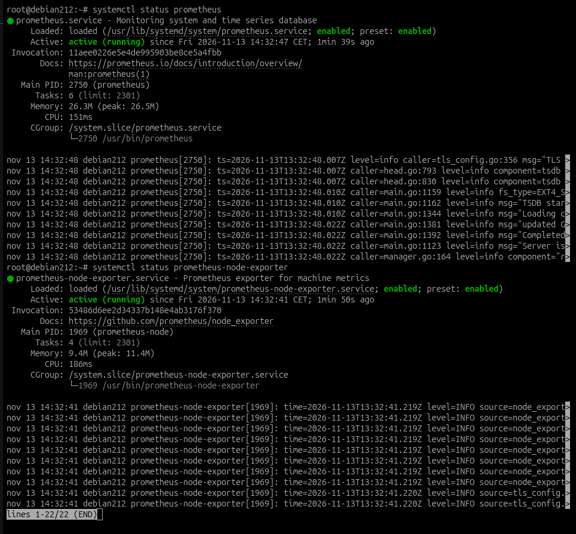

## Archivo de configuración

La configuración está en `/etc/prometheus/prometheus.yml`. Lo importante:

- `global.scrape_interval`: cada cuánto se recogen las métricas.
- `scrape_configs`: la lista de *jobs*. Cada uno tiene un `job_name` y sus `targets` (`IP:puerto` de los equipos a monitorizar).

Aquí definimos el job `prometheus` (Prometheus monitorizándose a sí mismo en el puerto 9090) y el job `node`, que apunta al Node Exporter del servidor (`172.26.2.62:9100`).

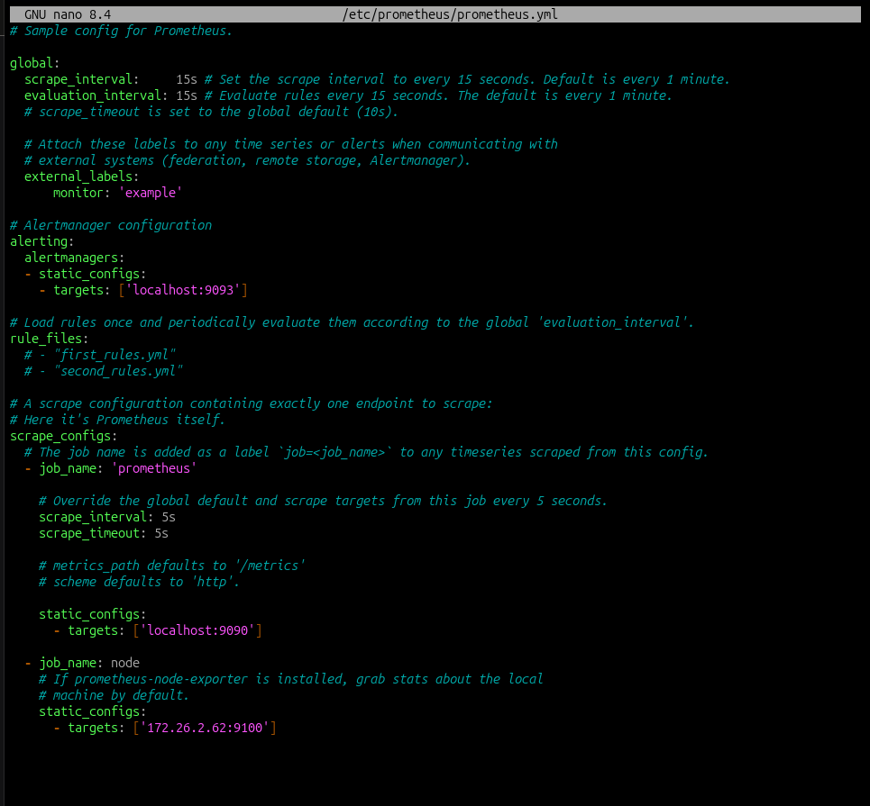

Tras modificarlo, reiniciamos el servicio:

```bash
systemctl restart prometheus
```

Accedemos a la interfaz web en `http://172.26.2.62:9090`:

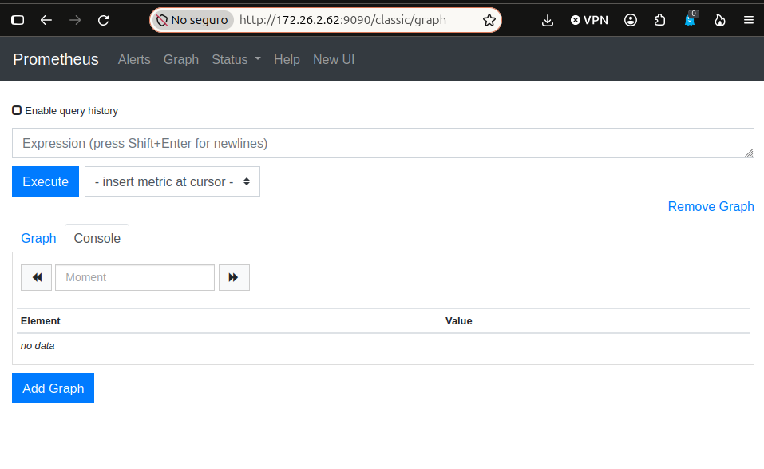

## Validación de ficheros YAML con yamllint

Un error de sintaxis en el YAML impide que Prometheus arranque, así que conviene validarlo antes. Instalamos `yamllint`:

```bash
sudo apt install yamllint
```

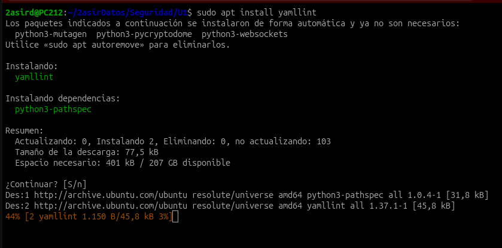

Validamos los ficheros de ejemplo de [`docs/FicherosPrometheus`](FicherosPrometheus). `prometheus-1.yml` es correcto, pero `prometheus-2.yml` da un error en la línea 4:

```bash
yamllint prometheus-1.yml
yamllint prometheus-2.yml
```

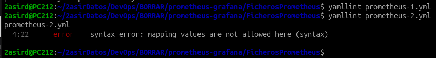

El fallo es de sangría: `scrape_interval` estaba al mismo nivel que `global` y `evaluation_interval` estaba indentado, así que YAML no sabía a qué clave pertenecía este último. Indentamos `scrape_interval` dentro de `global` para corregirlo:

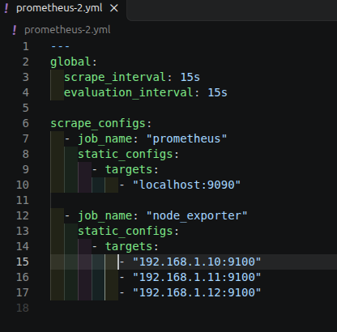

Y al volver a pasarlo ya no muestra errores:

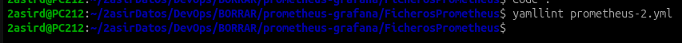

## Comprobación de los targets

En **Status → Targets** vemos que los dos jobs están en estado `UP`, es decir, que Prometheus consigue recoger sus métricas:

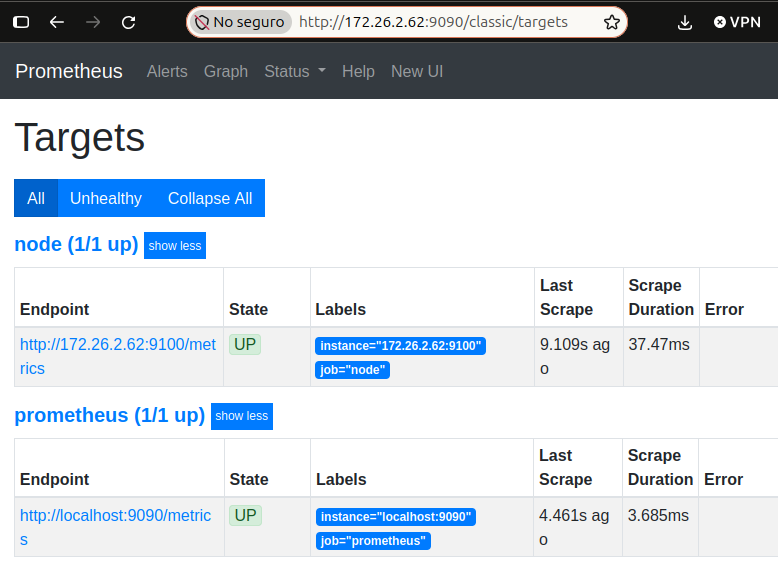

> **Nota:** las etiquetas `job="node"` y `job="prometheus"` salen del `job_name` que pusimos en `prometheus.yml`, y la etiqueta `instance` es el `target` (`IP:puerto`) de cada job. Si cambiamos el `job_name` en el fichero de configuración, cambia el nombre con el que aparece aquí, en las consultas y luego en Grafana.

## Primera consulta

Desde **Graph** lanzamos una consulta PromQL, por ejemplo `node_cpu_seconds_total`, que muestra el tiempo de CPU consumido en cada modo (`idle`, `user`, `system`...). Cada serie lleva las etiquetas `job` e `instance` que acabamos de ver:

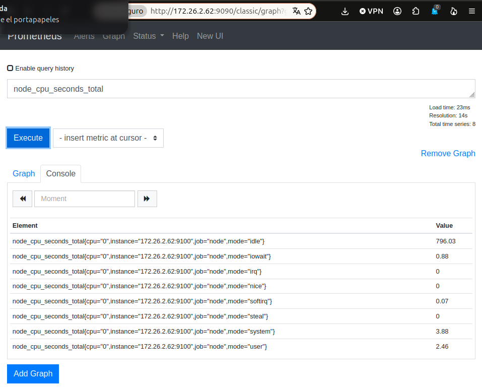

## Node Exporter

Node Exporter también tiene su propia página en el puerto 9100:

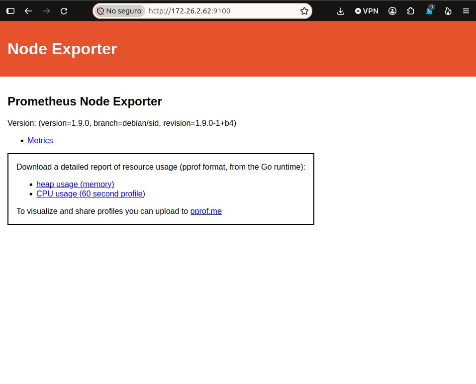

En `/metrics` está el texto en bruto con todas las métricas que expone, que es exactamente lo que Prometheus lee en cada *scrape*:

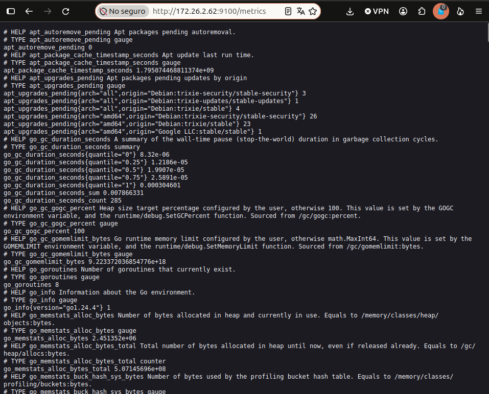
