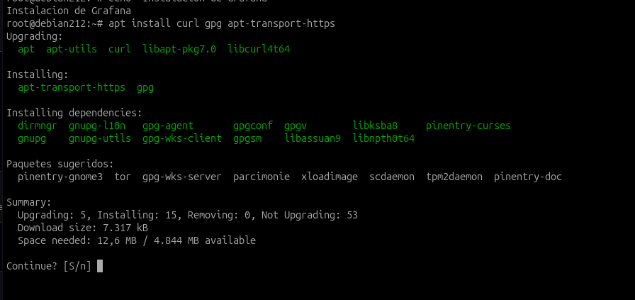
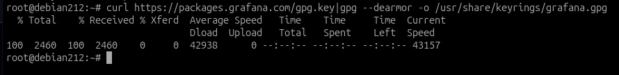
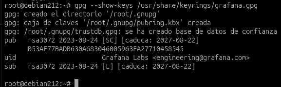
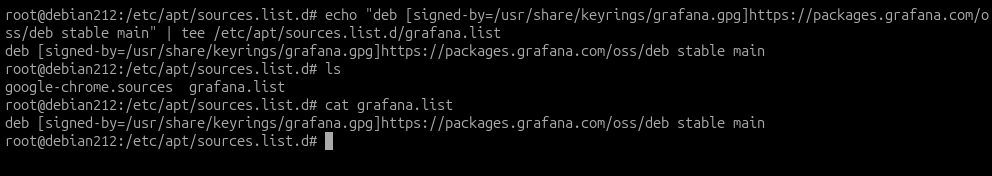
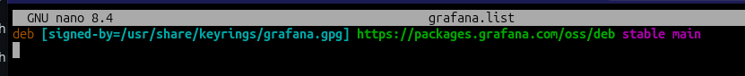
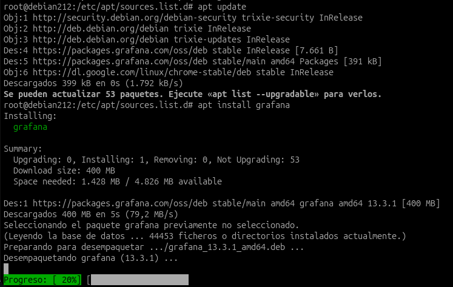
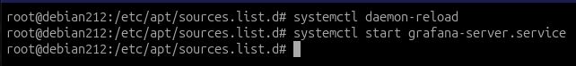
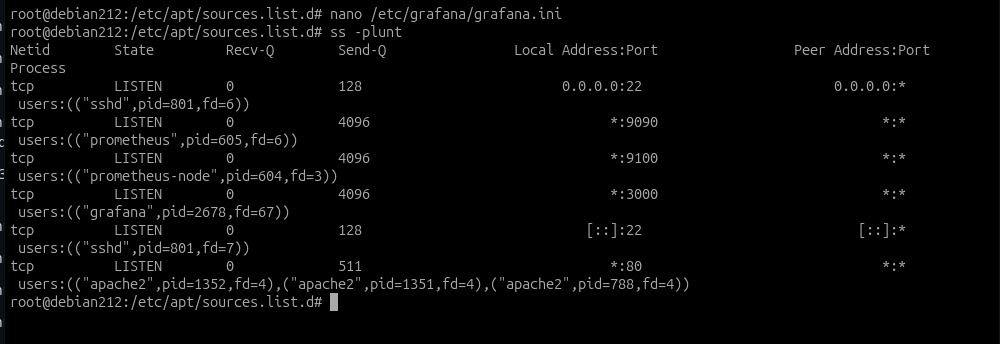
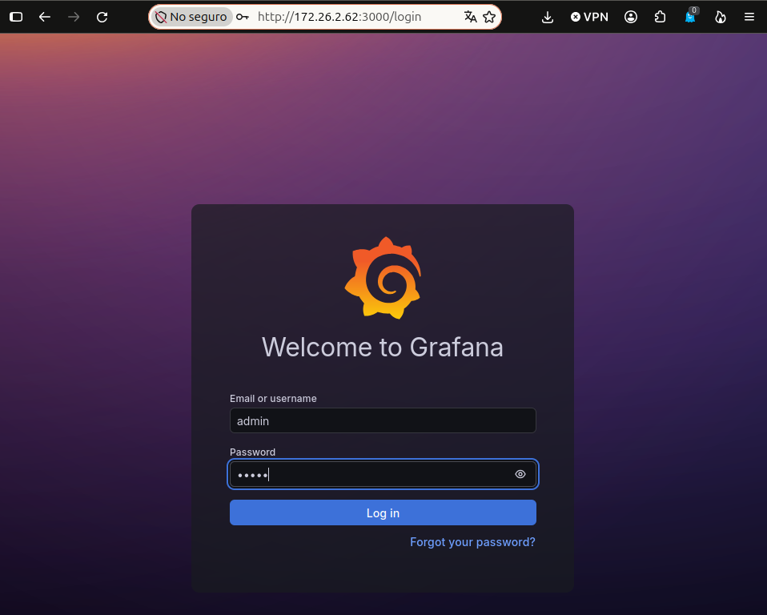
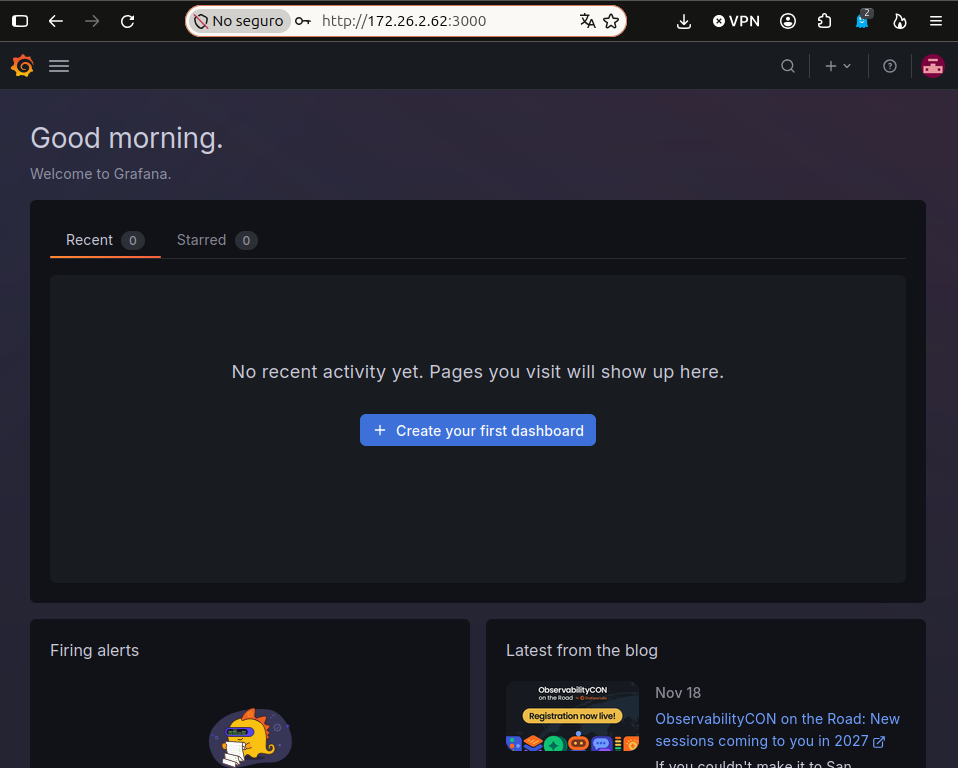

# 2. Instalación de Grafana

Grafana no está en los repositorios de Debian, así que lo instalamos desde el repositorio oficial de Grafana Labs.

## Dependencias

```bash
apt install curl gpg apt-transport-https
```



## Clave GPG del repositorio

Descargamos la clave pública con la que se firman los paquetes y la guardamos en el anillo de claves:

```bash
curl https://packages.grafana.com/gpg.key | gpg --dearmor -o /usr/share/keyrings/grafana.gpg
```



Comprobamos que la clave es la de Grafana Labs:

```bash
gpg --show-keys /usr/share/keyrings/grafana.gpg
```



## Añadir el repositorio

```bash
echo "deb [signed-by=/usr/share/keyrings/grafana.gpg] https://packages.grafana.com/oss/deb stable main" | tee /etc/apt/sources.list.d/grafana.list
```



> **Ojo:** en la captura anterior falta el espacio entre `]` y `https`, y con eso `apt` no reconoce bien la línea. Lo corregimos editando el fichero:



## Instalación

```bash
apt update
apt install grafana
```



Recargamos systemd y arrancamos el servicio:

```bash
systemctl daemon-reload
systemctl start grafana-server.service
```

Si queremos que arranque con el sistema, también ejecutamos `systemctl enable grafana-server.service`.



## Comprobación de puertos

La configuración de Grafana está en `/etc/grafana/grafana.ini`. Con `ss` comprobamos que tenemos escuchando Prometheus (9090), Node Exporter (9100) y Grafana (3000):

```bash
ss -plunt
```



## Acceso web

Entramos en `http://172.26.2.62:3000`. Las credenciales por defecto son `admin` / `admin`, y en el primer inicio de sesión pide cambiar la contraseña.




