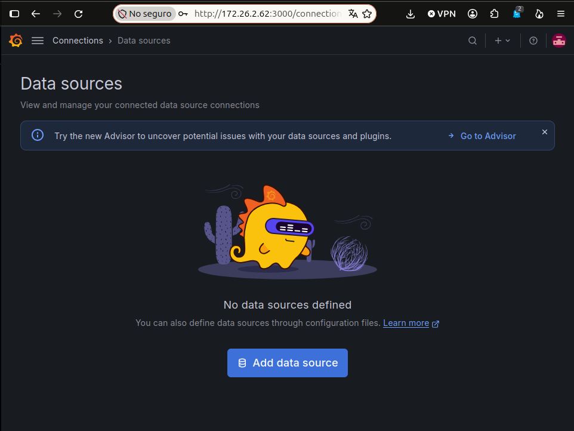
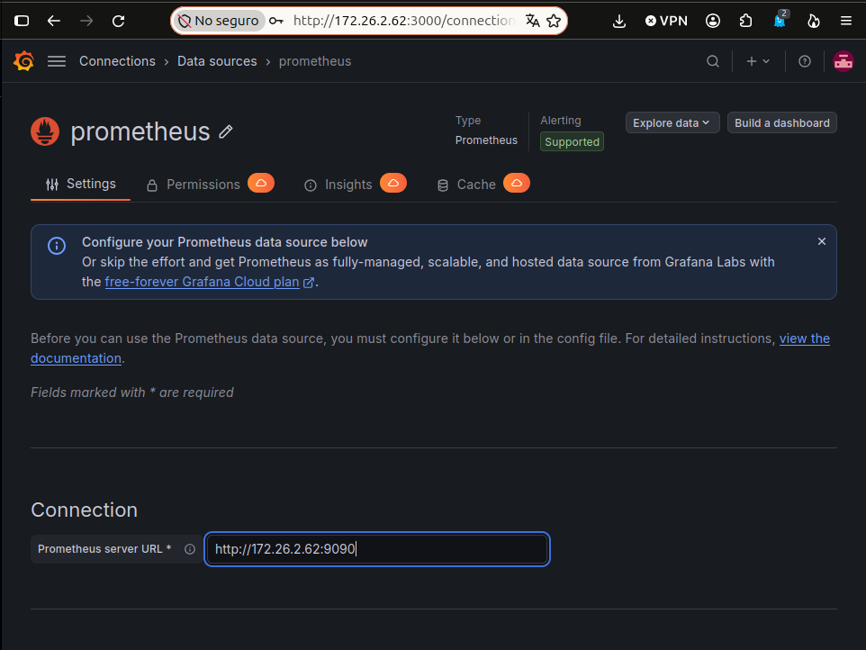
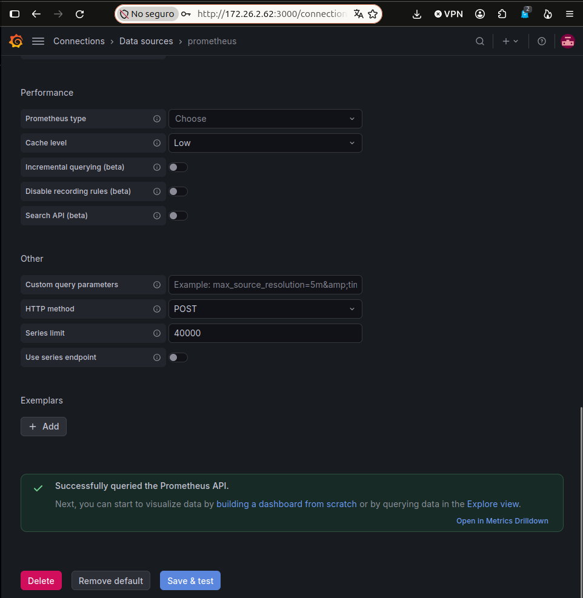
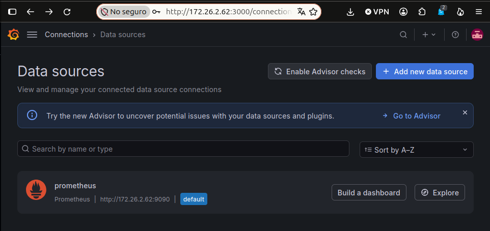
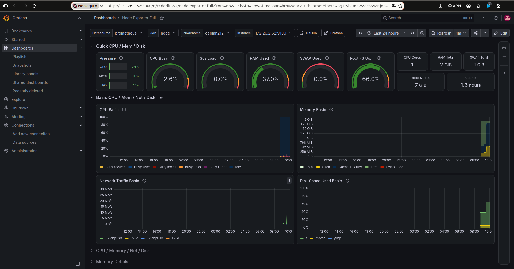

# 3. Añadir Prometheus como data source

Grafana no guarda métricas, así que hay que indicarle de dónde leerlas. Vamos a **Connections → Data sources**, que de momento está vacío, y pulsamos **Add data source**:



Elegimos **Prometheus** y en *Prometheus server URL* ponemos la dirección del servidor Prometheus:

```
http://172.26.2.62:9090
```



Dejamos el resto de opciones por defecto y pulsamos **Save & test**. Si todo va bien aparece *Successfully queried the Prometheus API*:



Ya aparece en la lista como fuente de datos por defecto:



## Importar un dashboard

En vez de crear los paneles desde cero, importamos el dashboard de la comunidad **Node Exporter Full** (ID `1860`) desde **Dashboards → New → Import**, y como fuente de datos elegimos `prometheus`.



Las variables de la parte superior del dashboard salen de las etiquetas de las métricas:

- **Datasource**: el *data source* que acabamos de crear (`prometheus`).
- **Job** (`node`): es el `job_name` que definimos en `/etc/prometheus/prometheus.yml`. Si en ese fichero le ponemos otro nombre al job, aquí aparecerá ese nombre.
- **Instance** (`172.26.2.62:9100`): es el `target` que pusimos en ese job, también en `prometheus.yml`.
- **Nodename** (`debian212`): este **no** viene de la configuración de Prometheus. Es el *hostname* del servidor, que Node Exporter lee del propio sistema (métrica `node_uname_info`).
